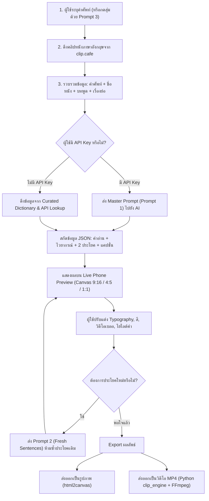

# 🎬 MoovyEng (Move0nyoung) — Project Documentation & AI Prompts Specification

เอกสารรวมรายละเอียดสถาปัตยกรรมโปรเจกต์ โครงสร้างระบบ และสเปกของ **Prompt AI ทั้งหมด** ที่ใช้งานภายในแพลตฟอร์ม **MoovyEng**

---

## 📌 สารบัญ (Table of Contents)

1. [ภาพรวมโปรเจกต์ (Project Overview)](#1-ภาพรวมโปรเจกต์-project-overview)
2. [สถาปัตยกรรมระบบและเทคโนโลยี (Tech Stack & Architecture)](#2-สถาปัตยกรรมระบบและเทคโนโลยี-tech-stack--architecture)
3. [โครงสร้างไฟล์ของโปรเจกต์ (Project Structure)](#3-โครงสร้างไฟล์ของโปรเจกต์-project-structure)
4. [รายละเอียด Prompt AI ทั้งหมดในระบบ (Comprehensive AI Prompts)](#4-รายละเอียด-prompt-ai-ทั้งหมดในระบบ-comprehensive-ai-prompts)
   - [Prompt 1: Master Contextual Flashcard Generator](#prompt-1-master-contextual-flashcard-generator-สร้างการ์ดคำศัพท์หลัก)
   - [Prompt 2: Fresh Sentences Crafting (Re-roll ประโยคใหม่ไม่ซ้ำเดิม)](#prompt-2-fresh-sentences-crafting-re-roll-แต่งประโยคใหม่)
   - [Prompt 3: Viral English Idiom / Slang Picker (สุ่มคำศัพท์ยอดฮิต)](#prompt-3-viral-english-idiom--slang-picker-สุ่มสำนวนยอดฮิต)
   - [เทคนิค Prompt Engineering ที่ใช้ในโปรเจกต์](#เทคนิค-prompt-engineering-ที่นำมาใช้)
5. [ระบบสำรองข้อมูลอัตโนมัติ (Zero-AI Fallback & Offline Engine)](#5-ระบบสำรองข้อมูลอัตโนมัติ-zero-ai-fallback--offline-engine)
6. [เวิร์กโฟลว์การทำงานแบบ End-to-End (System Workflow)](#6-เวิร์กโฟลว์การทำงานแบบ-end-to-end-system-workflow)
7. [ขั้นตอนการติดตั้งและการเปิดใช้งาน (Installation & Running)](#7-ขั้นตอนการติดตั้งและการเปิดใช้งาน-installation--running)

---

## 1. ภาพรวมโปรเจกต์ (Project Overview)

**MoovyEng** (หรือชื่อโค้ดเนมเดิม: `move0nyoung` / `moovying(En)`) คือเว็บแอปพลิเคชันและสตูดิโอสร้างสื่อการเรียนรู้ภาษาอังกฤษในรูปแบบ **Short-form Video & Visual Flashcards** สำหรับเผยแพร่บน Social Media (TikTok, Instagram Reels, YouTube Shorts, Facebook)

### จุดเด่นสำคัญ (Key Highlights)
- 🎥 **Real Movie Clips Scraper**: ดึงคลิปภาพยนตร์ภาษาอังกฤษเสียงจริง (Audio: EN) จากฐานข้อมูล `clip.cafe` มาเล่นในเฟรม 16:9 แบบเรียลไทม์ พร้อมเรื่องย่อและบทพูด
- 🧠 **Contextual AI Generation**: ใช้ AI วิเคราะห์คำศัพท์โดยอ้างอิงจากบทพูดและเนื้อเรื่องของภาพยนตร์ เพื่อสร้างประโยคตัวอย่างสั้นกระชับ (4-7 คำ) ที่ "เน้นจำฝังหัว"
- 🎨 **Canva & ElevenLabs Inspired Design**: ดีไซน์หน้าตาสะอาดตา Editorial Magazine สไตล์ ElevenLabs พร้อมเครื่องมือปรับแต่งข้อความ สี แบ็กกราวด์วิดีโอเบลอ (Backdrop Blur) และเอฟเฟกต์ตัวหนังสือระดับมืออาชีพ
- ⚡ **Multi-Provider AI Architecture**: รองรับ AI 7 ค่ายชั้นนำ (Google Gemini, OpenAI, DeepSeek, Groq Cloud, Anthropic Claude, xAI Grok, Mistral) พร้อมระบบ Auto-detect คีย์และดึงโมเดลอัตโนมัติ
- 🎞️ **Python & FFmpeg Video Export Engine**: มีเครื่องมือเรนเดอร์วิดีโอทั้งแคนวาส (ฉากหลัง + คำศัพท์ + วิดีโอหนัง + เสียง) ออกมาเป็นไฟล์ MP4 ตามอัตราส่วนต่างๆ (9:16, 4:5, 1:1, 16:9)

---

## 2. สถาปัตยกรรมระบบและเทคโนโลยี (Tech Stack & Architecture)

```
┌────────────────────────────────────────────────────────┐
│                   MoovyEng Studio                      │
├──────────────────────────┬─────────────────────────────┤
│   Next.js 14 App Router  │   Standalone HTML/JS UI     │
│   (app/page.jsx, /edit)  │   (index.html, edit.html)   │
└────────────┬─────────────┴──────────────┬──────────────┘
             │                            │
             ▼                            ▼
┌──────────────────────────┐   ┌─────────────────────────┐
│ Next.js API Routes       │   │ Node.js Media Proxy     │
│ - /api/cafe/search       │◄──┼─ server.js (Port 3001)  │
│ - /api/vocab/lookup      │   │ - Clip scraping proxy   │
│ - /api/cafe/clean-cache  │   │ - Range video stream    │
└────────────┬─────────────┘   └──────────┬──────────────┘
             │                            │
             ▼                            ▼
┌────────────────────────────────────────────────────────┐
│             External & Background Services             │
├─────────────────────┬───────────────────┬──────────────┤
│ Multi-Provider AI   │ clip.cafe API     │ Python/FFmpeg│
│ (Gemini, OpenAI,    │ (Scraped clips,   │ clip_engine  │
│  Groq, DeepSeek...) │  audio, metadata) │ (Video Render│
└─────────────────────┴───────────────────┴──────────────┘
```

### รายละเอียดเทคโนโลยี (Tech Stack)
- **Frontend Core**: Next.js 14 (App Router), React 18, Tailwind CSS, Lucide Icons, FontAwesome
- **Typography & Web Fonts**: EB Garamond, Waldenburg, Inter, Prompt, Itim, Noto Sans Thai, Sarabun, IBM Plex Sans Thai
- **Media & Proxy Server**: Node.js (`server.js`) จัดการ bypass CORS, แคชภาพขนาดย่อ, สตรีมวิดีโอแบบ byte-range
- **Video Rendering Core**: Python 3 (`clip_engine.py`) ควบคุม `ffmpeg` และ `ffprobe` ในการตรวจจับและตัดขอบดำ (Black bars auto-detect), แปลงขนาด และรวมหลายเลเยอร์เป็น MP4
- **Snapshot Generator**: `html2canvas` สำหรับส่งออกภาพนิ่ง PNG/JPEG คุณภาพสูง

---

## 3. โครงสร้างไฟล์ของโปรเจกต์ (Project Structure)

```
move0nyoung/
├── app/                                # Next.js 14 App Router
│   ├── api/
│   │   ├── cafe/
│   │   │   ├── search/route.js         # API ดึงคลิปหนังจาก clip.cafe
│   │   │   └── clean-cache/route.js    # API ล้างไฟล์แคชใน clips_cache
│   │   └── vocab/
│   │       └── lookup/route.js         # API ค้นหาคำศัพท์ (Offline/Fallback)
│   ├── edit/
│   │   └── page.jsx                    # หน้า Studio สำหรับหน้าจอมือถือ
│   ├── globals.css                     # Global styles, variables & animations
│   ├── layout.jsx                      # Root layout พร้อมลิงก์ Web Fonts
│   └── page.jsx                        # หน้าหลัก Desktop Studio
│
├── components/                         # React UI Components
│   ├── CanvaColorPicker.jsx            # Color Picker สไตล์ Canva พร้อมสวอชสี
│   ├── CanvaTextAnimationsModal.jsx    # Modal เลือกแอนิเมชันข้อความ
│   ├── CanvaTextEffectsModal.jsx       # Modal ปรับเอฟเฟกต์เงา/เรืองแสงข้อความ
│   ├── CustomDialog.jsx                # กล่องแจ้งเตือน/ยืนยัน (Custom Modal)
│   ├── ElevenLabsDropdown.jsx          # เมนูดรอปดาวน์สไตล์ ElevenLabs
│   ├── ExportModal.jsx                 # Modal เรนเดอร์รูปภาพและส่งออกวิดีโอ
│   ├── MobileBottomNav.jsx             # แถบนำทางด้านล่างสำหรับสมาร์ตโฟน
│   ├── PhonePreview.jsx                # จำลองการ์ดหน้าจอมือถือ (Live Canvas)
│   ├── StudioHeader.jsx                # เฮดเดอร์ด้านบน (Logo, Undo/Redo, Theme)
│   ├── TextFormattingSuite.jsx         # กล่องเครื่องมือจัดแต่งฟอนต์ ขนาด สี ตัวหนา
│   ├── Toast.jsx                       # แจ้งเตือนสถานะมุมจอ (Toast Notification)
│   ├── ToolStep1AI.jsx                 # ขั้นตอนที่ 1: เลือกค่าย AI, ใส่คีย์, เลือกรุ่น
│   ├── ToolStep2Vocab.jsx              # ขั้นตอนที่ 2: กรอกคำศัพท์, ดึงคลิป, สร้างเนื้อหา
│   ├── ToolStep3Ratio.jsx              # ขั้นตอนที่ 3: เลือกอัตราส่วน, แบ็กกราวด์, วิดีโอเบลอ
│   └── ToolStep4Social.jsx             # ขั้นตอนที่ 4: ตั้งค่าโปรไฟล์, แคปชั่น, ดาวน์โหลด
│
├── context/
│   └── VocabContext.jsx                # หัวใจหลัก State Management & AI Invocations
│
├── lib/
│   ├── constants.js                    # ข้อมูลคงที่ โมเดลเริ่มต้น คลังคำศัพท์ ตัวอย่าง
│   ├── curatedVocab.js                 # พจนานุกรมคำศัพท์และสำนวนสำรอง (No-AI)
│   ├── ipaToThai.js                    # อัลกอริทึมแปลง IPA เป็นคำอ่านภาษาไทย
│   └── utils.js                        # Helper functions, CSS class merge
│
├── js/                                 # ไฟล์ Vanilla JavaScript สำหรับ Standalone HTML
│   ├── ai.js                           # ระบบ AI Provider & Prompt สำหรับ index.html
│   ├── constants.js                    # ค่าคงที่สำหรับโหมด Standalone
│   ├── editor.js                       # จัดการฟอร์มและการแก้ไข
│   ├── export.js                       # จัดการส่งออกภาพและวิดีโอ
│   ├── preview.js                      # อัปเดตพรีวิวบน index.html
│   ├── scraper.js                      # สื่อสารกับ Proxy Server ดึงคลิป
│   ├── theme.js                        # จัดการธีม Light/Dark
│   └── ui.js                           # ควบคุม Event ทั่วไป
│
├── public/                             # Static assets, รูปโลโก้โปร่งใส
│   ├── icon.png
│   ├── icon.svg
│   └── transparent_character.svg
│
├── clips_cache/                        # โฟลเดอร์จัดเก็บคลิปและภาพขนาดย่อที่แคชไว้
├── exports/                            # โฟลเดอร์บันทึกไฟล์วิดีโอ MP4 ที่เรนเดอร์เสร็จ
├── clip_engine.py                      # เอ็นจิ้น Python สำหรับดาวน์โหลด ครอป และรวมวิดีโอ
├── server.js                           # Node.js Media Scraper & Streaming Proxy (Port 3001)
├── package.json                        # Node dependencies & scripts
├── tailwind.config.js                  # Tailwind configuration
└── verify_master_prompt.py             # Playwright E2E UI Verification Script
```

---

## 4. รายละเอียด Prompt AI ทั้งหมดในระบบ (Comprehensive AI Prompts)

ในโปรเจกต์ MoovyEng มีการออกแบบ Prompt อย่างพิถีพิถันเพื่อตอบโจทย์การเรียนรู้ที่จำง่าย รวดเร็ว และเชื่อมโยงกับบริบทภาพยนตร์ โดยแบ่งออกเป็น 3 Prompt หลัก ดังนี้:

---

### Prompt 1: Master Contextual Flashcard Generator (สร้างการ์ดคำศัพท์หลัก)

- **ไฟล์ที่ใช้งาน**:
  - `context/VocabContext.jsx` (ฟังก์ชัน `generateAiContent`)
  - `js/ai.js` (ฟังก์ชัน `buildMovieContextualPrompt`)
- **วัตถุประสงค์**:
  - วิเคราะห์คำศัพท์หรือสำนวนที่ผู้ใช้ป้อน
  - เชื่อมโยงกับคลิปภาพยนตร์ที่ดึงมาจาก `clip.cafe` (ชื่อเรื่อง, บทพูดจริงในฉาก, เรื่องย่อ)
  - สังเคราะห์ข้อมูลเพื่อสร้างการ์ดคำศัพท์ที่สมบูรณ์ ได้แก่ คำอ่าน IPA, คำอ่านไทย, ความหมายไทย, สูตรไวยากรณ์, ประโยคตัวอย่าง 2 ประโยค, และแคปชั่นโซเชียลมีเดีย
- **โมเดลที่แนะนำ**:
  - `gemini-2.0-flash`, `gemini-1.5-flash`, `gpt-4o-mini`, `llama-3.3-70b-versatile`, `deepseek-chat`

#### ตัวแปรที่ส่งเข้า Prompt (Input Parameters):
- `${targetWord}`: คำศัพท์ หรือ สำนวนเป้าหมาย (เช่น `"break a leg"`, `"bite the bullet"`)
- `${primaryClip.title}`: ชื่อภาพยนตร์และปีที่ฉาย (เช่น `"Inception (2010)"`)
- `${primaryClip.quote}` หรือ `${primaryClip.fullTranscript}`: ประโยคบทพูดจริงภาษาอังกฤษที่ตัวละครพูดในฉาก
- `${primaryClip.movieSummary}`: เรื่องย่อของภาพยนตร์ฉากนั้น

#### โครงสร้าง Master Prompt (ภาษาอังกฤษ):

```text
You are an elite English tutor creating viral educational flashcards for Thai students.
Analyze this English word/phrase: "${targetWord}".
Real movie context: "${primaryClip.title}" quote: "${primaryClip.quote}"

CRITICAL RULES:
1. Provide EXACTLY 2 example sentences ("ex1En" and "ex2En"). DO NOT provide a 3rd sentence!
2. Each English example sentence MUST be VERY SHORT (4 to 7 words maximum), super punchy, simple, and unforgettable (ขอประโยคที่ง่ายและสั้น 2 ประโยค เน้นจำฝังหัว)!
3. Grammar formula / Usage rule ("grammar"):
CRITICAL GOAL: Teach the grammatical structure, part of speech, or sentence syntax for "${targetWord}".
❌ ABSOLUTELY FORBIDDEN:
- NEVER output just the word itself (e.g. "${targetWord}")!
- NEVER output just the word with its Thai translation in parentheses (e.g. "${targetWord} (คำแปลไทย)")! That is 100% duplicate and forbidden!

✅ MUST PROVIDE REAL GRAMMATICAL VALUE:
A) If it is used in a sentence (Verb, Phrasal Verb, Adjective, Noun, Idiom Clause):
- Provide the real sentence construction structure with simple standard placeholders: S, Someone, Something, V.1, V.ing, be + ..., etc.
- If it's an idiom used as a clause or exclamation (e.g. "speak of the devil"): show where it goes in a sentence!
  • Example: Speak of the devil, + S + V  (สำนวนอุทาน: ใช้วางหน้าประโยคเมื่อคนที่เพิ่งพูดถึงเดินเข้ามาพอดี)
  • Example: S + tell Someone to + break a leg  (ใช้อวยพรขอให้โชคดีก่อนขึ้นแสดง/สอบแข่งขัน)
  • Example: Something + is a piece of cake  (ใช้บอกว่าเรื่องนั้นง่ายมากเหมือนปอกกล้วย)
  • Example: S + call off + Something  (Phrasal Verb: ยกเลิกนัดหมายหรือกิจกรรม)
  • Example: be + proud of + Someone/Something  (Adj: ต้องใช้คู่กับ preposition 'of' เสมอ)
  • Example: S + look forward to + V.ing / Something  (กริยาสำนวน: หลัง to ต้องเป็น V.ing เสมอ)

B) If it is a Standalone Expression, Conversational Response, or Slang (where no S+V formula fits):
- Provide the exact usage context in Thai explaining WHEN and HOW to say it:
  • Example for "My bad": [คำอุทานกันเอง] ใช้พูดขอโทษทันทีเมื่อทำผิดพลาดเล็กน้อย (แทน My mistake)
  • Example for "No way": [คำอุทาน] ใช้แสดงความตกใจ ประหลาดใจ หรือปฏิเสธอย่างสิ้นเชิง (ไม่มีทาง/เป็นไปไม่ได้)
  • Example for "Tell me about it": [สำนวนตอบรับ] ใช้เห็นพ้องอย่างแรงกล้าเพราะเคยเจอเรื่องเดียวกัน (นั่นน่ะสิ)
  • Example for "Touché": [คำอุทาน] ใช้ยอมรับเมื่ออีกฝ่ายพูดจี้ใจดำหรือโต้กลับได้อย่างเจ็บแสบ

- ALWAYS keep it to 1 concise line.
- NEVER use emojis.
4. Thai translations ("ex1Th", "ex2Th") MUST be short, direct, and natural.
5. "socialCaption": Short Thai caption teaching ${targetWord} with relevant hashtags (#MoovyEng).

Respond with ONLY valid JSON with no markdown formatting:
{
  "phonetic": "/.../ (IPA format)",
  "thaiRead": "คำอ่านออกเสียงภาษาไทย (ไม่มีวงเล็บ)",
  "meaning": "คำแปลความหมายภาษาไทยสั้นกระชับ",
  "grammar": "โครงสร้างไวยากรณ์ หรือ บริบทการใช้งาน (ตามกฎข้อ 3)",
  "ex1En": "Very short sentence 1 (4-7 words)",
  "ex1Th": "คำแปลไทยสั้นกระชับ",
  "ex2En": "Very short sentence 2 (4-7 words)",
  "ex2Th": "คำแปลไทยสั้นกระชับ",
  "socialCaption": "แคปชั่นสอนคำศัพท์ ${targetWord} สั้นกระชับ พร้อมแฮชแท็ก"
}
```

#### ตัวอย่างผลลัพธ์ JSON (Example Output):
```json
{
  "phonetic": "/breɪk ə leɡ/",
  "thaiRead": "เบรค อะ เลก",
  "meaning": "ขอให้โชคดี (นิยมใช้อวยพรก่อนขึ้นแสดง)",
  "grammar": "wish + Someone + to + break a leg",
  "ex1En": "Go out there and break a leg!",
  "ex1Th": "ออกไปทำให้เต็มที่ ขอให้โชคดีนะ!",
  "ex2En": "Break a leg on your test today.",
  "ex2Th": "ขอให้ทำข้อสอบได้คะแนนดีๆ โชคดีนะ",
  "socialCaption": "สำนวน 'Break a leg' ไม่ได้แปลว่าขาหัก แต่แปลว่าขอให้โชคดี! 🎭✨ มักใช้อวยพรก่อนขึ้นเวที #เรียนภาษาอังกฤษ #MoovyEng #คำศัพท์ภาษาอังกฤษ"
}
```

---

### Prompt 2: Fresh Sentences Crafting (Re-roll แต่งประโยคใหม่)

- **ไฟล์ที่ใช้งาน**:
  - `context/VocabContext.jsx` (ฟังก์ชัน `craftSentencesFromClip`)
- **วัตถุประสงค์**:
  - ใช้เมื่อผู้ใช้ต้องการเปลี่ยนประโยคตัวอย่างใหม่ (ปุ่ม "แต่งประโยคใหม่" / Refresh) โดยรักษาคำศัพท์และบริบทภาพยนตร์เดิมไว้
  - ป้องกันไม่ให้ AI แต่งประโยคซ้ำกับของเดิมที่มีอยู่ในหน้าจอ (`Anti-Repetition Rule`)
  - มี Timeout รวดเร็วเป็นพิเศษ (3.5 วินาที) เพื่อ UX ที่ลื่นไหล

#### ตัวแปรที่ส่งเข้า Prompt (Input Parameters):
- `${targetWord}`: คำศัพท์เป้าหมาย
- `${primaryClip.title}`: ชื่อภาพยนตร์ (ถ้ามี)
- `${primaryClip.quote}`: ประโยคในคลิป (ถ้ามี)
- `${ex1En}`: ประโยคตัวอย่างที่ 1 เดิม (ส่งไปเพื่อสั่งห้ามซ้ำ)
- `${ex2En}`: ประโยคตัวอย่างที่ 2 เดิม (ส่งไปเพื่อสั่งห้ามซ้ำ)

#### โครงสร้าง Prompt (ภาษาอังกฤษ):

```text
You are an elite English tutor for Thai learners.
Target phrase/word: "${targetWord}"
Real movie context: "${primaryClip.title}" Quote: "${primaryClip.quote}"

TASK: Provide 2 FRESH, PUNCHY, VERY SHORT example sentences (4 to 7 words maximum each) using "${targetWord}".
CRITICAL: DO NOT repeat these previous sentences:
1. "${ex1En}"
2. "${ex2En}"
Give completely NEW, exciting, and memorable examples!

Respond with ONLY valid JSON:
{
  "ex1En": "Sentence 1 (4-7 words)",
  "ex1Th": "คำแปลไทยสั้นกระชับ",
  "ex2En": "Sentence 2 (4-7 words)",
  "ex2Th": "คำแปลไทยสั้นกระชับ"
}
```

#### ตัวอย่างผลลัพธ์ JSON (Example Output):
```json
{
  "ex1En": "You've got this, break a leg!",
  "ex1Th": "เธอทำได้อยู่แล้ว ลุยให้เต็มที่เลย!",
  "ex2En": "Smile, breathe, and break a leg!",
  "ex2Th": "ยิ้มไว้ หายใจลึกๆ แล้วโชคดีนะ!"
}
```

---

### Prompt 3: Viral English Idiom / Slang Picker (สุ่มสำนวนยอดฮิต)

- **ไฟล์ที่ใช้งาน**:
  - `context/VocabContext.jsx` (ฟังก์ชัน `randomWordWithAi`)
  - `js/ai.js` (ฟังก์ชัน `randomWordWithAi`)
- **วัตถุประสงค์**:
  - เมื่อผู้ใช้กดปุ่มรูปลูกเต๋า (Random Word) ระบบจะเรียก AI ให้คัดสรรสำนวน สแลง หรือ Phrasal Verb ภาษาอังกฤษที่เป็นที่นิยมและผู้เรียนชาวไทยชื่นชอบ
  - กำหนดให้ตอบเฉพาะตัวคำศัพท์เพียวๆ โดยไม่มีเครื่องหมายคำพูด ไม่มีคำบรรยายประกอบ เพื่อนำไปใส่ในช่องกรอกคำศัพท์และเริ่มค้นหาคลิปทันที

#### โครงสร้าง Prompt (ภาษาอังกฤษ):

```text
Give me exactly ONE popular, practical, or viral English idiom, phrasal verb, or slang that Thai learners love to learn. Reply with ONLY the English phrase itself, no punctuation, no quotes, no extra words. Example: bite the bullet
```

#### พารามิเตอร์การเรียกใช้ (Configuration):
- **Temperature**: `0.9` (เพื่อให้เกิดความหลากหลายในการสุ่ม ไม่ซ้ำคำเดิมบ่อยๆ)
- **Response Format**: Plain text (หรือสกัดค่าเฉพาะสตริง)
- **ตัวอย่างผลลัพธ์ที่ได้**:
  - `bite the bullet`
  - `piece of cake`
  - `spill the tea`
  - `under the weather`
  - `cut corners`

---

### เทคนิค Prompt Engineering ที่นำมาใช้

1. **Strict Negative Constraints (กฎข้อห้ามเชิงลบที่เด็ดขาด)**:
   - ห้ามสร้างประโยคที่ 3 เด็ดขาด (`DO NOT provide a 3rd sentence!`) เนื่องจากพื้นที่หน้าจอสมาร์ตโฟน (9:16) มีจำกัด
   - จำกัดความยาวประโยคอย่างชัดเจน (`4 to 7 words maximum`) เพื่อให้อ่านจบได้ใน 1-2 วินาทีบนวิดีโอสั้น
   - ห้ามใช้คำฟุ่มเฟือยในสูตรไวยากรณ์ เช่น ห้ามขึ้นต้นว่า `Subject +` หรือใช้คำว่า `โครงสร้าง:`, `ตัวอย่าง:`
   - ห้ามใส่อิโมจิในช่องไวยากรณ์หรือประโยค (`NO emojis in grammar or examples`) เพื่อไม่ให้กวนสายตาในเลเยอร์กราฟิก
2. **Context Grounding (การตรึงบริบทด้วยเนื้อหาภาพยนตร์จริง)**:
   - นำข้อมูล Transcript บทพูดและเนื้อเรื่องย่อของภาพยนตร์จริงมาฉีดเข้าไปใน Prompt ทำให้ประโยคตัวอย่างที่สร้างขึ้นมีความสมจริง มีอารมณ์เหมือนบทสนทนาในภาพยนตร์ ไม่ใช่ประโยคแห้งๆ จากตำราเรียน
3. **Structured JSON Output & Clean Parsing**:
   - บังคับใช้ `response_format: { type: 'json_object' }` สำหรับ OpenAI/Groq/DeepSeek และ `generationConfig: { responseMimeType: 'application/json' }` สำหรับ Gemini
   - มีชุด Regex ทำความสะอาด Markdown Fence (เช่น ````json ... ````) และตัดข้อความส่วนเกินก่อน Parse ป้องกันการแครช
4. **Resilience & Automatic Provider Fallback**:
   - เมื่อเชื่อมต่อ Gemini มีระบบจับ Error `HTTP 429` (Rate limit) แล้วสลับไปยังโมเดลสำรองอัตโนมัติ เช่น สลับจาก `gemini-2.0-flash` ไปยัง `gemini-1.5-flash` หรือ `gemini-2.0-flash-lite`

---

## 5. ระบบสำรองข้อมูลอัตโนมัติ (Zero-AI Fallback & Offline Engine)

หากผู้ใช้ไม่มี API Key, เน็ตหลุด หรือโควตา AI หมด MoovyEng ได้สร้างระบบ **Offline Data & Microservices** มารองรับแบบครบวงจร 100% โดยที่ผู้ใช้ยังสามารถใช้งานได้อย่างต่อเนื่อง:

1. **Curated Vocab Dictionary (`lib/curatedVocab.js`)**:
   - ฐานข้อมูลคำศัพท์และสำนวนยอดฮิตกว่า 20 รายการ พร้อมประโยคตัวอย่าง คำแปลไทย และความหมายที่จัดเตรียมไว้อย่างประณีต
2. **Curated Sentence Varieties (`lib/constants.js`)**:
   - คลังประโยคตัวอย่างสำรองถึง 5-10 รูปแบบต่อคำศัพท์ เมื่อกดปุ่ม "แต่งประโยคใหม่" ระบบจะหมุนเวียน (Cycle) ประโยคใหม่มาแสดงทันทีแม้ไม่มี AI
3. **IPA to Thai Phonetic Converter (`lib/ipaToThai.js`)**:
   - โมดูลแปลงสัญลักษณ์สัทอักษรสากล (IPA) เป็นคำอ่านภาษาไทยตามหลักการออกเสียงอย่างแม่นยำ
4. **Live Vocab Lookup Endpoint (`app/api/vocab/lookup/route.js`)**:
   - ค้นหาคำศัพท์ผ่าน `dictionaryapi.dev` + ดึงประโยคตัวอย่างจากคลังภาษา `Tatoeba Corpus` + แปลความหมายผ่าน Google Translation Endpoint

---

## 6. เวิร์กโฟลว์การทำงานแบบ End-to-End (System Workflow)



---

## 7. ขั้นตอนการติดตั้งและการเปิดใช้งาน (Installation & Running)

### ความต้องการของระบบ (Prerequisites)
- **Node.js**: เวอร์ชัน 18 ขึ้นไป
- **Python**: เวอร์ชัน 3.10 ขึ้นไป
- **FFmpeg & FFprobe**: ติดตั้งใน System PATH เพื่อใช้ในการตัดขอบดำและเรนเดอร์วิดีโอ

### 1. ติดตั้ง Dependencies
```bash
npm install
```

### 2. รัน Media Scraper Proxy Server (Port 3001)
เปิด Terminal ที่ 1 แล้วรัน:
```bash
node server.js
```
*เซิร์ฟเวอร์นี้จะทำหน้าที่เป็น Proxy ดึงคลิปจาก clip.cafe, สตรีมวิดีโอ และประสานงานกับ Python Engine*

### 3. รัน Next.js Application (Port 3000)
เปิด Terminal ที่ 2 แล้วรัน:
```bash
npm run dev
```
เข้าใช้งานผ่านเบราว์เซอร์ได้ที่: [http://localhost:3000](http://localhost:3000) หรือใช้งานหน้าจอโทรศัพท์มือถือที่ [http://localhost:3000/edit](http://localhost:3000/edit)

### 4. การตั้งค่า API Key
ในหน้าเว็บ ขั้นตอนที่ 1 (AI Model Configuration):
1. เลือกผู้ให้บริการ (เช่น Google Gemini, Groq, OpenAI หรือ Anthropic)
2. วาง API Key ของคุณในช่อง **API Key**
3. ระบบจะตรวจสอบความถูกต้องและดึงรายการโมเดลที่ใช้งานได้มาแสดงในดรอปดาวน์ทันที

### 5. การทดสอบระบบอัตโนมัติ (Automated E2E Verification)
สามารถรันสคริปต์ Playwright เพื่อทดสอบระบบ UI, การสลับธีม, การเปิดวิดีโอแบ็คกราวด์ และการทำงานของส่วนประกอบต่างๆ:
```bash
py verify_master_prompt.py
```

---

*เอกสารฉบับนี้จัดทำขึ้นสำหรับโปรเจกต์ MoovyEng เพื่อใช้เป็นมาตรฐานในการพัฒนา บำรุงรักษา และขยายความสามารถของระบบ AI ในอนาคต*
