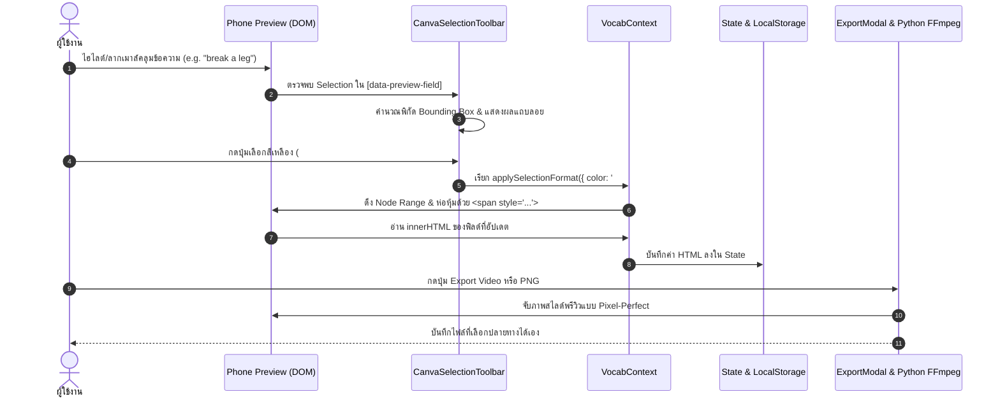

# MoovyEng — Comprehensive Design Specification & System Architecture
> เอกสารวิเคราะห์และอธิบายการออกแบบส่วนต่อประสานผู้ใช้ (UI/UX Design Specification) ทั้งหน้าต่างเดสท็อป (Desktop Studio Workspace) และหน้าต่างโทรศัพท์ (Mobile Preview & Edit View) ครอบคลุมทุกคอมโพเนนต์ ฟังก์ชันการทำงาน และภาพแคปเจอร์หน้าจอจริง

---

## 1. ปรัชญาการออกแบบและอัตลักษณ์ของระบบ (Design Philosophy & Identity)

MoovyEng ถูกออกแบบภายใต้แนวคิด **"ElevenLabs Atmospheric Editorial × Canva Typography Suite"** โดยผสานความเรียบหรู คมชัด ระดับนิตยสารแฟชั่น/สิ่งพิมพ์สากล เข้ากับเครื่องมือปรับแต่งตัวอักษรและสื่อมัลติมีเดียที่ใช้งานง่ายและทรงพลัง:

* **Atmospheric Pastel Gradient Orbs**: พื้นหลังลอยด้วยลูกแก้วแสงออโรร่าสีพาสเทลแบบ ElevenLabs (Mint `#a7e5d3`, Peach `#f4c5a8`, Lavender `#c8b8e0`, Sky `#a8c8e8`) สร้างมิติความลึกที่นุ่มนวล สบายตา
* **High-Contrast Monochrome Base**: โครงสร้างหลักใช้สี Charcoal `#0c0a09` ตัดกับพื้นผิวหินอ่อนและกระดาษขาว `#fafafa` พร้อมเส้นขอบคมชัดระดับไมโคร `#e7e5e4` (Dark: `#292524`)
* **transitions.dev Micro-Interactions**: ปุ่มกดและโมดูลทั้งหมดตอบสนองด้วยสปริงเคิร์ฟ `cubic-bezier(0.16, 1, 0.3, 1)` และเอฟเฟกต์การกด ยุบตัว นุ่มนวล เสมือนแอปพลิเคชันระดับเนทีฟ

---

## 2. หน้าต่างเดสท็อป (Desktop Studio Workspace View)

หน้าต่างแสดงผลบนคอมพิวเตอร์และหน้าจอขนาดใหญ่ (ความกว้างตั้งแต่ `1024px` ขึ้นไป) จัดวางแบบ **2-Column Responsive Master Architecture**:


```
+---------------------------------------------------------------------------------------------------------+
|                                    MOOVYENG DESKTOP STUDIO WORKSPACE                                    |
+------------------------------------+--------------------------------------------------------------------+
|  LEFT COLUMN: PINNED PHONE CANVAS  |  RIGHT COLUMN: STUDIO TOOLS WORKSPACE                              |
|  (Sticky Preview, Aspect Ratios)   |  +--------------------------------------------------------------+  |
|                                    |  | StudioHeader: Voice Model, Quick Search, Export, Undo/Redo   |  |
|  - iOS Status Bar (Auto Contrast)  |  +------------------------------+-------------------------------+  |
|  - Brand Avatar & Channel Name     |  | LEFT SUB-COL (7 Cols)        | RIGHT SUB-COL (5 Cols)        |  |
|  - Word / IPA / Thai Read          |  |                              |                               |  |
|  - 16:9 Clip Box (Python Streamed) |  | [Step 1: AI Engine Vault]    | [Step 3: Ratio & Sequence]    |  |
|  - Meaning & Frameless Grammar     |  | - Gemini / OpenAI / Groq     | - 6 Aspect Ratios             |  |
|  - Punchy Examples (4-7 words)     |  |                              | - Movie Backdrop Blur         |  |
|  - Floating Selection Toolbar      |  | [Step 2: Vocab & Clips]      | - 12 Gradients + Custom       |  |
|                                    |  | - Canva Formatting Suite     | - Multi-Clip Queue (Drag)     |  |
|                                    |  | - Movie Clips 3-Col Grid     |                               |  |
|                                    |  | - All 6 Regenerate Buttons   | [Step 4: Profile & Caption]   |  |
|                                    |  |                              | - Avatar, Handle, Hashtags    |  |
+------------------------------------+------------------------------+-------------------------------+--+
```

### 2.1 คอลัมน์ซ้าย: แคนวาสโทรศัพท์พรีวิวสด (Pinned Phone Canvas Preview)
คอลัมน์ซ้ายถูกตรึงแบบ Sticky ไว้ที่ตำแหน่งมุมมองสายตาของผู้ใช้เสมอ เพื่อให้เห็นผลลัพธ์การแก้ไขแบบเรียลไทม์ 100%:

1. **iOS Dynamic Status Bar**:
   - แถบสถานะระบบ iOS 17 ด้านบนสุด (เวลา 9:41, Dynamic Island Pill, สัญญาณ 5G, Wi-Fi, แบตเตอรี่เต็ม)
   - ปรับสีอัตโนมัติ (Auto Contrast): สว่างบนพื้นหลังมืด และเข้มบนพื้นหลังสว่าง
   - ไม่ถูกนำไปติดในไฟล์ Export เพื่อความสะอาดตา
2. **ส่วนหัวของบัตรคำ (Header Card)**:
   - รูปโปรไฟล์ช่องแบบวงกลม (Avatar) รองรับทั้งการอัปโหลดไฟล์จากเครื่อง หรือใส่รูป URL จากเว็บ
   - ชื่อช่อง `@MoovyEng` ปรับฟอนต์และสีได้อิสระ
3. **บล็อกคำศัพท์หลัก (Primary Vocabulary Block)**:
   - **Target Word**: ตัวอักษรคำศัพท์หลัก แสดงผลคมชัด รองรับทั้งแบบข้อความตรง และแบบตัวอักษรโค้ง (Curved Text SVG)
   - **IPA Phonetic Guide**: สัทอักษรการออกเสียงสากล เช่น `/breɪk ə leɡ/`
   - **Thai Reading**: คำอ่านออกเสียงภาษาไทยแบบไม่มีวงเล็บกวนตา
4. **บล็อกคลิปภาพยนตร์ (16:9 Movie Clip Card Box)**:
   - อัตราส่วนฟิกซ์ 16:9 ไร้ขอบดำ (`object-cover` สเกล 103% แนบสนิทกับขอบมน)
   - สตรีมวิดีโอจากภาพยนตร์ฮอลลีวูดจริงผ่าน Python Engine พร้อมเสียงพูดจริงของตัวละคร
   - ลายน้ำชื่อภาพยนตร์และปีที่ฉายมุมซ้ายบน เช่น *"Inception (2010)"*
   - เมื่อคลิกจะเล่น/หยุดวิดีโอทันที พร้อมไอคอน Play Overlay เมื่อชี้เมาส์
5. **บล็อกความหมายและไวยากรณ์ไร้กรอบ (Frameless Grammar & Examples Card)**:
   - **ความหมายภาษาไทย (Meaning)**: ฟอนต์ตัวหนา ขนาดใหญ่ ชัดเจน ไร้เครื่องหมายคำพูด
   - **สูตรไวยากรณ์ (Grammar Formula)**: โครงสร้างกระชับ 1 บรรทัดตามกฎ Rule 3 มีคำแทน `Someone`, `Something`, `V.1`, `V.ing` ชัดเจน
   - **ประโยคตัวอย่าง 2 ประโยค (Ex 1 & Ex 2)**: ประโยคสั้นกะทัดรัด (4–7 คำ) เน้นจำง่าย พร้อมคำแปลไทยบรรทัดถัดไป
6. **Canva Floating Selection Toolbar (แถบเครื่องมือลอยเมื่อคลุมข้อความ)**:
   - เมื่อผู้ใช้ลากเมาส์คลุมข้อความใดๆ บนบัตรคำ แถบเครื่องมือแคปซูลทรง Canva จะลอยขึ้นมาเหนือคำที่เลือกทันที
   - อนุญาตให้ใส่ **ตัวหนา (B)**, **ตัวเอียง (I)**, **ขีดเส้นใต้ (U)**, **สีข้อความเฉพาะส่วน (7 เฉดสี + ตัวดูดสี)**, **ปรับขนาดตัวอักษร (A- / A+)**, **แบบอักษร**, **เอฟเฟกต์พิเศษ** และ **ล้างสไตล์เฉพาะจุด**

---

### 2.2 คอลัมน์ขวา: สตูดิโอควบคุมและตกแต่ง (Studio Tools Workspace)

#### 1) Studio Header (แถบเมนูด้านบน)
* **Brand Signature**: โลโก้ MoovyEng พร้อมชื่อสตูดิโอ
* **ElevenLabs Voice Selector**: เมนูดรอปดาวน์เลือกเสียงพากย์ AI จาก ElevenLabs (เช่น Adam, Rachel, Nicole, Antoni)
* **Search Tools Bar**: ค้นหาเครื่องมือและเมนูในสตูดิโอได้อย่างรวดเร็ว โดยจะไฮไลต์เฉพาะการ์ดที่ตรงกับคำค้นหา
* **Studio Actions**:
  - สลับโหมดสี (Dark / Light Theme)
  - สลับภาษา (TH / EN)
  - ประวัติการแก้ไข Undo (`Ctrl+Z`) และ Redo (`Ctrl+Y`) บันทึกอัตโนมัติสูงสุด 30 สเต็ป
  - ปุ่ม Reset คืนค่าเริ่มต้น และปุ่ม Clean Cache ล้างไฟล์ชั่วคราว
  - ปุ่ม **Export Video & Image** ขนาดใหญ่

#### 2) Step 1: AI Engine Configuration Vault
* เลือกระบบ AI อัจฉริยะได้ 5 ค่ายยักษ์ใหญ่: **Google Gemini**, **OpenAI**, **Groq (Llama 3.3 Ultra Fast)**, **DeepSeek (V3 & R1)**, และ **xAI (Grok)**
* ช่องกรอก API Key พร้อมระบบจัดเก็บปลอดภัยใน `localStorage` ของเบราว์เซอร์
* ดรอปดาวน์เลือกโมเดลตามค่าย เช่น `gemini-2.0-flash`, `gpt-4o`, `llama-3.3-70b-versatile`

#### 3) Step 2: Vocabulary, Movie Clips & Canva Typography Suite
* **แถบค้นหาคำศัพท์อัจฉริยะ**: ค้นหาคลิปหนังจาก Clip.cafe และแปลความหมายด้วย AI พร้อมกันในคลิกเดียว พร้อมปุ่มทอยลูกเต๋าสุ่มคำศัพท์ และปุ่มค้นหาเฉพาะคลิปหนัง
* **ตารางคลิปภาพยนตร์ 3 คอลัมน์**: แสดงตัวอย่างคลิปหนังที่ตรงกับคำศัพท์ พร้อมระบบ **Touch-Hold / Hover Preview** ให้ดูวิดีโอตัวอย่างสั้นๆ ได้ก่อนเลือกเข้าคิว
* **Canva Text Formatting Suite (แถบสไตล์อักษร Canva)**:
  - แท็บเลือกเป้าหมาย: ทั้งหมด, คำศัพท์, สัทอักษร, คำอ่านไทย, ความหมาย, ไวยากรณ์, ตัวอย่าง 1, ตัวอย่าง 2, ชื่อช่อง
  - ดรอปดาวน์แบบอักษรยอดนิยม 10 ฟอนต์: Garuda, Inter, Prompt, Kanit, Sarabun, Mitr, Chonburi, Fredoka, Itim, EB Garamond
  - ตัวปรับขนาดอักษรละเอียด (ปุ่ม `+`, `-` และช่องพิมพ์ตัวเลข 8–180px)
  - ปุ่มเลือกสีข้อความ (จานสีสำเร็จรูป 12 สี + Canva Spectrum Color Picker)
  - ปุ่มสไตล์ตัวหนา, ตัวเอียง, ขีดเส้นใต้, ขีดฆ่า, ตัวพิมพ์ใหญ่/เล็ก, จัดตำแหน่ง (ซ้าย, กลาง, ขวา, ชิดขอบ)
  - ปุ่มเปิด **Canva Text Effects Studio Modal** (21 รูปแบบพิเศษ)
  - ปุ่มเปิด **Canva Text Animations Studio Modal** (14 รูปแบบเคลื่อนไหว)
* **ชุดปุ่ม Regenerate แยกรายองค์ประกอบ (New Feature)**:
  - 🔄 **Regenerate IPA / Thai Read**: สร้างสัทอักษรและคำอ่านไทยใหม่
  - 🔄 **Regenerate Meaning**: สร้างคำแปลภาษาไทยใหม่ที่กระชับและตรงบริบท
  - 🔄 **Regenerate Grammar**: สร้างสูตรไวยากรณ์ใหม่ตามกฎ Rule 3
  - 🔄 **Regenerate Ex 1**: แต่งประโยคตัวอย่างที่ 1 (4–7 คำ) พร้อมแปลไทยใหม่
  - 🔄 **Regenerate Ex 2**: แต่งประโยคตัวอย่างที่ 2 (4–7 คำ) พร้อมแปลไทยใหม่
  - ✨ **Craft Both Examples**: แต่งประโยคตัวอย่างใหม่ทั้ง 2 ประโยคพร้อมกัน

#### 4) Step 3: Aspect Ratio, Backdrop Canvas & Clip Sequence
* **6 อัตราส่วนมาตรฐานโซเชียลมีเดีย**:
  - `9:16` (Reels, TikTok, YouTube Shorts)
  - `2:3` (Portrait Post)
  - `4:5` (Instagram / Facebook Feed)
  - `1:1` (Square Post)
  - `3:2` (Classic Landscape)
  - `16:9` (YouTube / X Landscape)
* **Movie Backdrop Blur**: ตัวเลือกใช้คลิปภาพยนตร์เป็นพื้นหลังบัตรคำแบบเบลอ พร้อมสไลเดอร์ปรับความเบลอ (0–40px) และความทึบของเลเยอร์มืด (0–90%)
* **Canvas Gradient Background**: สีพื้นหลังการ์ดสำเร็จรูป 12 คู่สี หรือผสมสี Gradient เองด้วยตัวดูดสี Color 1 และ Color 2
* **Multi-Clip Sequence Queue**: ตัวจัดการคิวคลิปวิดีโอ สามารถสลับลำดับคลิป (Reorder) หรือลบคลิปออกจากคิวได้อิสระ

#### 5) Step 4: Profile & Social Caption
* **อัปโหลดรูปโปรไฟล์**: รองรับไฟล์ภาพจากเครื่องหรือใส่ลิงก์ภาพ URL พร้อมปุ่มลบรูปภาพ
* **ชื่อบัญชีผู้ใช้**: เช่น `@MoovyEng`
* **Social Caption**: ช่องแสดงข้อความแคปชั่นสำหรับโพสต์ลงโซเชียลมีเดีย พร้อมแฮชแท็กที่ AI แต่งให้อัตโนมัติ
* 🔄 **Regenerate Caption Button**: ปุ่มกดสร้างแคปชั่นใหม่ทันใจ
* 📋 **One-Click Copy**: ปุ่มคัดลอกข้อความแคปชั่นลงคลิปบอร์ดทันที

---

### 2.3 Canva Text Effects Studio Modal (หน้าต่างสตูดิโอลักษณะพิเศษตัวอักษร)


หน้าต่างโมดอลขนาดใหญ่สำหรับการตกแต่งเอฟเฟกต์ตัวอักษรเสมือน Canva Pro ประกอบด้วย 3 ส่วนหลัก:
1. **พรีวิวแบบสด (Interactive Live Preview Canvas)**: แสดงข้อความตัวอย่างพร้อมเอฟเฟกต์และสีที่เลือกแบบเรียลไทม์
2. **หมวดลักษณะพิเศษพื้นฐาน (Basic Effects)**:
   - ไม่มี (None), เงา (Shadow), เรืองแสง (Lift/Glow), เงาสะท้อน (Echo/Offset), เค้าร่าง (Outline), แบ็คกราวน์ (Background Box), อักษรประกบ (Splice), กลวง (Hollow), นีออน (Neon), ทันทีทันใด (Glitch)
3. **หมวดลักษณะพิเศษขั้นสูง (Advanced Effects)**:
   - Sci-fi (นีออนตารางอวกาศ), ทีวีเสีย (TV Glitch RGB Shift), ยุค 70 (Retro 3D Extrusion), การพิมพ์สกรีน (Screen Print Halftone), หนังตะวันตก (Western Script), กราฟิตี้ (Street Graffiti), ฟอง (Bubble 3D Shaded), แอโรบิก (Aerobic 80s Italic), อาร์เคด (Arcade 8-Bit Pixel), คอสมิก (Cosmic Purple), พิกเซล (Retro Cyberpunk)
4. **หมวดรูปทรง (Shape & Curve)**:
   - ปรับข้อความโค้ง (Curved Text) พร้อมสไลเดอร์ปรับระดับความโค้งตั้งแต่ 0% ถึง 100%

---

## 3. หน้าต่างโทรศัพท์ (Mobile Phone View & Studio Navigation)

สำหรับผู้ใช้งานบนสมาร์ทโฟนหรือหน้าจอขนาดเล็ก (ความกว้างต่ำกว่า `1024px`) ระบบจะปรับเปลี่ยนเลย์เอาต์เป็น **App-Like Fullscreen Experience**:

| 1. Mobile Phone Preview View | 2. Mobile Studio Tools View (`/edit`) |
| :---: | :---: |
|  |  |

### 3.1 หน้าพรีวิวบนมือถือ (Mobile Phone Preview: `/`)
* **เต็มความกว้างหน้าจอ (100% Viewport Height)**: บัตรคำศัพท์จะขยายพอดีกับขนาดหน้าจอสมาร์ทโฟนของผู้ใช้ เสมือนกำลังเปิดดูแอป TikTok หรือ Instagram Reels
* **ปุ่มเข้าสู่สตูดิโอ (Studio Button)**: ปุ่มไอคอนดินสอมุมขวาบนของบัตรคำ กดเพื่อสลับไปยังหน้าต่างเครื่องมือปรับแต่ง (`/edit`)
* **การควบคุมวิดีโอด้วยการสัมผัส (Touch Playback)**: แตะที่กล่องวิดีโอเพื่อเล่นหรือหยุดคลิปหนังพร้อมเสียงพูด
* **Touch-Friendly Selection Formatting**: แตะลากคลุมข้อความเพื่อเปิดแถบเครื่องมือ Canva ลอยสำหรับปรับแต่งสีและขนาดเฉพาะคำได้อย่างลื่นไหล

### 3.2 หน้ารวมเครื่องมือบนมือถือ (Mobile Studio Tools: `/edit`)
* **Sticky Header**: แถบด้านบนสุดมีปุ่มลูกศรย้อนกลับไปยังหน้าพรีวิว โลโก้ และช่องค้นหาเครื่องมือ (Search Tools)
* **การ์ดเครื่องมือ 4 หมวดพับได้ (Collapsible Cards)**:
  - Step 1: AI Engine Vault
  - Step 2: Vocabulary, Clips & Canva Text Formatting Suite
  - Step 3: Aspect Ratio, Backdrop & Queue
  - Step 4: Profile & Social Caption
* **Mobile Floating Bottom Navigation Bar (แถบนำทางลอยด้านล่าง)**:
  - แถบนำทางด้านล่างออกแบบให้รองรับสรีระนิ้วหัวแม่มือ (Thumb-Friendly Navigation):
    1. **AI Studio**: แตะเพื่อเลื่อนหน้าจอไปยังส่วนเครื่องมือ AI
    2. **Ratio Switcher**: แตะเพื่อสลับสัดส่วนวิดีโอแบบด่วน (`9:16` -> `4:5` -> `1:1`)
    3. **Copy Caption**: แตะเพื่อคัดลอกแคปชั่นคำศัพท์ลงคลิปบอร์ดทันที
    4. **Export Action**: แตะเพื่อเปิดหน้าต่างบันทึกรูปภาพและวิดีโอ

---

## 4. ระบบการจัดรูปแบบข้อความเฉพาะส่วนที่เลือก (Selection Formatting Architecture)



1. **DOM Range Detection**: ใช้ Native Selection API ตรวจสอบว่าโหนดข้อความที่เลือกอยู่ภายใต้แท็กที่มีแอตทริบิวต์ `data-preview-field` หรือไม่
2. **Non-Destructive Wrapping**: ใช้ `Range.extractContents()` เพื่อดึงโหนดที่เลือก จากนั้นบรรจุลงใน `<span class="custom-styled-selection" style="...">` แล้วแทรกกลับเข้าไปที่ตำแหน่งเดิมผ่าน `Range.insertNode()`
3. **State Synchronization**: ดึง `innerHTML` ของคอนเทนเนอร์เป้าหมายมาอัปเดตลงใน React State ทันที ทำให้ฟอร์แมตคงอยู่แม้สลับหน้าจอ
4. **Pixel-Perfect Export**: เมื่อส่งออกเป็นภาพ PNG หรือวิดีโอ MP4 ระบบจะจับภาพจาก DOM จริง ทำให้การจัดรูปแบบข้อความเฉพาะส่วนถูกเรนเดอร์ลงในวิดีโอ 100%

---

## 5. ตารางสรุปองค์ประกอบ UI ทั้งหมด (Design Element Catalog)

| หมวดหมู่ | คอมโพเนนต์ | หน้าต่างที่แสดง | หน้าที่และรายละเอียด |
| :--- | :--- | :--- | :--- |
| **Preview** | `PhonePreview.jsx` | Desktop & Mobile | แคนวาสจำลองโทรศัพท์ แสดงผลคำศัพท์ คลิปหนัง ไวยากรณ์ และตัวอย่างประโยค |
| **Toolbar** | `CanvaSelectionToolbar.jsx` | Desktop & Mobile | แถบเครื่องมือลอยเหนือข้อความที่คลุม รองรับตัวหนา เอียง ขีดเส้นใต้ สี ขนาด และเอฟเฟกต์ |
| **Header** | `StudioHeader.jsx` | Desktop | แถบเครื่องมือหลักบนคอมพิวเตอร์ รวมตัวเลือกเสียง ElevenLabs, ค้นหา, ธีม, และ Export |
| **Tool Step 1** | `ToolStep1AI.jsx` | Desktop & Mobile (`/edit`) | จัดการ AI Provider (Gemini, OpenAI, Groq, DeepSeek, xAI), API Key, และโมเดล |
| **Tool Step 2** | `ToolStep2Vocab.jsx` | Desktop & Mobile (`/edit`) | ค้นหาคำศัพท์, คลิปหนัง, ตารางเลือกคลิป, **ปุ่ม Regenerate ทุกองค์ประกอบ**, และแผง Canva |
| **Typography** | `TextFormattingSuite.jsx` | Desktop & Mobile (`/edit`) | แผงควบคุมไทโปรกราฟีระดับมืออาชีพ รองรับทั้งแบบเลือกฟิลด์ และแบบเชื่อมโยงกับข้อความที่คลุม |
| **Effects** | `CanvaTextEffectsModal.jsx` | Desktop & Mobile | สตูดิโอลักษณะพิเศษตัวอักษร 21 แบบ พร้อมพรีวิวสดและสไลเดอร์ความโค้งข้อความ |
| **Animations** | `CanvaTextAnimationsModal.jsx` | Desktop & Mobile | สตูดิโอแอนิเมชันข้อความเคลื่อนไหว 14 รูปแบบ |
| **Color Picker**| `CanvaColorPicker.jsx` | Desktop & Mobile | จานสีสเปกตรัม HSV/Hex พร้อมชุดสีสกัดจากวิดีโอภาพยนตร์ |
| **Tool Step 3** | `ToolStep3Ratio.jsx` | Desktop & Mobile (`/edit`) | เลือก 6 อัตราส่วนภาพ, Movie Backdrop Blur, สีพื้นหลังการ์ด, และคิวรวมคลิป |
| **Tool Step 4** | `ToolStep4Social.jsx` | Desktop & Mobile (`/edit`) | อัปโหลดรูปโปรไฟล์, กำหนดชื่อช่อง, แคปชั่นโซเชียล, และปุ่ม Regenerate แคปชั่น |
| **Navigation** | `MobileBottomNav.jsx` | Mobile (`/edit`) | แถบนำทางด้านล่าง 4 ฟังก์ชันสำหรับสมาร์ทโฟน |
| **Export** | `ExportModal.jsx` | Desktop & Mobile | หน้าต่างพรีวิวก่อนเรนเดอร์ ส่งออกภาพ PNG คมชัดสูง และวิดีโอ MP4 รวมเสียงจริง |
